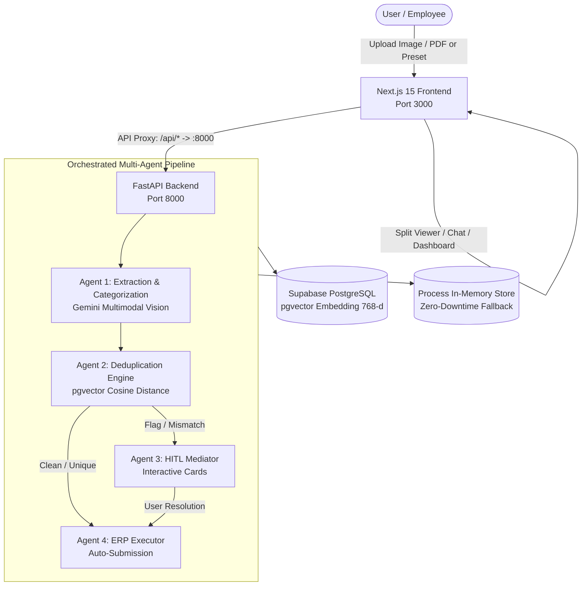

# Project Handoff Documentation: Autonomous Expense Tracker & Reimbursement Platform

## 1. Executive Summary

The **Autonomous Expense Tracker & Reimbursement Platform** is an enterprise-grade agentic application designed to automate receipt ingestion, multimodal optical/text extraction, duplicate fraud prevention via vector search, human-in-the-loop (HITL) exception mediation, and automated ERP submission.

The project features a **Next.js 15** frontend paired with a high-performance **Python FastAPI** backend, backed by **Supabase PostgreSQL with pgvector** for high-dimensional semantic similarity matching and lifecycle persistence.

---

## 2. Architecture & Tech Stack



### Stack Breakdown

| Component | Technology | Role |
| :--- | :--- | :--- |
| **Frontend** | Next.js 15 (App Router), TypeScript, Tailwind CSS, Lucide Icons | Chat UI, Split-screen PDF/Receipt Viewer, Claims Dashboard, HITL Cards |
| **Backend** | Python 3.9+, FastAPI, Uvicorn, Pydantic | Agent pipeline orchestrator, REST API routes, Vector embedding client |
| **LLM / Vision** | Google Gemini API (`gemini-3.1-flash-lite`, `gemini-3.8-flash`) | Multimodal receipt reading, line item parsing, OCR fallback heuristics |
| **Embeddings** | Gemini Embedding (`gemini-embedding-2` / 768 dimensions) | High-dimensional semantic embeddings for vendor, date, and amount |
| **Database** | Supabase (PostgreSQL with `pgvector` extension) | Primary persistent store for expenses, embeddings, and chat history |
| **E2E Testing** | Playwright (Chromium Headless) | Automated portal test scenarios and video recording |

---

## 3. The 4-Agent Pipeline

### Agent 1: Multimodal Extraction & Categorization
- **Purpose**: Ingests uploaded PNG/JPEG/PDF documents.
- **Output**: Extracts `vendor_name`, `bill_date`, `total_amount`, `currency`, `payment_mode`, `line_items`, and categorizes `bill_type` (`CAB_LOCAL`, `FLIGHT`, `FOOD`, `FUEL`, `HOTEL`, etc.).
- **Resilience**: Features automated fallback to deterministic heuristic parsing if external Vision APIs reject raw inline PDF bytes.

### Agent 2: pgvector De-duplication Engine
- **Purpose**: Computes vector embeddings of claims and evaluates cosine distance against historical claims in the database.
- **Thresholds**:
  - `Similarity >= 0.95`: **Definite Duplicate** — Halts pipeline and issues a blocker alert.
  - `0.85 <= Similarity < 0.95`: **Potential Duplicate** (e.g., Round trip cabs with identical amounts) — Routes to Agent 3 for human judgment.
  - `Similarity < 0.85`: Verified as unique claim.

### Agent 3: Human-in-the-Loop (HITL) Mediator
- **Purpose**: Handles edge cases requiring human clarification before entering the financial ledger:
  1. **Potential Duplicate Override**: Allows the user to confirm round trips or unique trips via a 1-click button.
  2. **Missing Metadata**: If receipt image is blurry, damaged, or obscured, prompts the user with inline editable fields.
  3. **Math Mismatch**: Flags discrepancies between line item sums and total invoice amounts.

### Agent 4: ERP Settlement Executor
- **Purpose**: Updates the claim state to `Pending Approval` (or `Settlement Processing` / `Paid`), assigns approval routing, and logs an immutable audit trail.

---

## 4. Database Schema (Supabase PostgreSQL)

### `expenses` Table
```sql
CREATE EXTENSION IF NOT EXISTS vector;

CREATE TABLE expenses (
    id UUID PRIMARY KEY DEFAULT gen_random_uuid(),
    user_id TEXT NOT NULL,
    bill_type TEXT NOT NULL,
    bill_date DATE,
    vendor_name TEXT NOT NULL,
    total_amount NUMERIC(12,2) NOT NULL,
    currency TEXT DEFAULT 'INR',
    payment_mode TEXT DEFAULT 'UPI',
    remarks TEXT,
    specific_details JSONB DEFAULT '{}'::jsonb,
    status TEXT DEFAULT 'Draft',
    embedding vector(768),
    created_at TIMESTAMPTZ DEFAULT NOW(),
    updated_at TIMESTAMPTZ DEFAULT NOW()
);
```

### `conversations` Table
```sql
CREATE TABLE conversations (
    id TEXT PRIMARY KEY,
    user_id TEXT NOT NULL,
    title TEXT NOT NULL,
    created_at TIMESTAMPTZ DEFAULT NOW(),
    updated_at TIMESTAMPTZ DEFAULT NOW()
);
```

### `chat_messages` Table
```sql
CREATE TABLE chat_messages (
    id UUID PRIMARY KEY DEFAULT gen_random_uuid(),
    conversation_id TEXT REFERENCES conversations(id) ON DELETE CASCADE,
    sender TEXT NOT NULL, -- 'user' | 'assistant' | 'system'
    text TEXT,
    files JSONB DEFAULT '[]'::jsonb,
    events JSONB DEFAULT '[]'::jsonb,
    hitl_cards JSONB DEFAULT '[]'::jsonb,
    draft_cards JSONB DEFAULT '[]'::jsonb,
    created_at TIMESTAMPTZ DEFAULT NOW()
);
```

---

## 5. Repository Structure

```
AITASK/
├── backend/
│   ├── agents/
│   │   ├── deduplication_agent.py   # pgvector similarity matching
│   │   ├── erp_executor.py          # Final state transitions
│   │   ├── extraction_agent.py      # Multimodal receipt parsing
│   │   ├── hitl_mediator.py         # Exception & corner-case evaluation
│   │   └── orchestrator.py          # Multi-agent pipeline controller
│   ├── llm/
│   │   ├── client.py                # Gemini Vision API caller + fallback
│   │   └── embeddings.py            # Vector embedding generator
│   ├── routes/
│   │   ├── chat.py                  # POST /api/chat
│   │   ├── conversations.py         # GET/POST/PATCH/DELETE /api/conversations
│   │   ├── erp.py                   # GET/POST /api/erp
│   │   └── expenses.py              # GET/POST/PATCH /api/expenses
│   ├── config.py                    # Environment & credential loaders
│   ├── database.py                  # Supabase client + in-memory store
│   ├── main.py                      # FastAPI application entrypoint
│   └── test_backend.py              # Backend integration test suite
├── src/
│   ├── app/
│   │   ├── api/                     # Next.js fallback API routes
│   │   ├── globals.css              # Dark-mode styling
│   │   ├── layout.tsx               # Root layout
│   │   └── page.tsx                 # Main application dashboard
│   ├── components/
│   │   ├── ChatInterface.tsx        # Chat stream & prompt composer
│   │   ├── ClaimsTable.tsx          # Expense table view
│   │   ├── DashboardTab.tsx         # Expense lifecycle & analytics
│   │   ├── DraftActionCard.tsx      # Draft action card (View/Submit)
│   │   ├── DraftReviewModal.tsx     # Full draft editor modal
│   │   ├── InteractiveCard.tsx      # HITL cards (Override/Manual entry)
│   │   ├── PdfReceiptSplitViewer.tsx# Side-by-side receipt preview
│   │   └── TopNavigation.tsx        # Header & tab switcher
│   └── lib/
│       ├── agents/                  # Frontend agent types
│       └── llm/factory.ts           # Frontend LLM caller & heuristic fallback
├── test_recordings/
│   └── all_test_scenarios_walkthrough.webm  # Playwright recorded video
├── next.config.mjs                  # Proxy rewrites: /api/* -> :8000
├── package.json                     # Node scripts & dependencies
├── requirements.txt                 # Python dependencies
├── render.yaml                      # Render cloud deployment blueprint
├── start_backend.sh                 # Backend runner script
└── record_tests.py                  # Playwright video recording script
```

---

## 6. Verified Test Scenarios

The system has been verified across 5 critical edge cases:

| Scenario | Trigger / Input | Expected Pipeline Behavior | Status |
| :--- | :--- | :--- | :--- |
| **1. Clean Cab Slip** | Uber receipt (₹450) | Extracted with 100% accuracy, formatted into Draft Card, allows instant submission to ERP. | ✅ Verified |
| **2. Duplicate Bill** | Identical copy of ₹450 Uber receipt | Agent 2 pgvector similarity exceeds 0.95. Claim blocked with duplicate warning banner. | ✅ Verified |
| **3. Round Trip Cab** | Return Uber cab (₹450) | High similarity caught by Agent 2; Agent 3 presents HITL Card to confirm unique trip override. | ✅ Verified |
| **4. Multi-Page Bill** | Travel PDF (Flight + Meals) | Multi-item document parsed into separate expense records with itemized line breakdowns. | ✅ Verified |
| **5. Blurry Receipt** | Obscured date/amount | Pipeline halts; Agent 3 renders manual resolution input card for user to input missing data. | ✅ Verified |

---

## 7. Environment Variables Configuration

Create a `.env.local` file in the project root:

```ini
# LLM Provider
NEXT_PUBLIC_LLM_PROVIDER="gemini"
GEMINI_API_KEY="your_gemini_api_key"
GEMINI_MODEL="gemini-3.1-flash-lite"
GEMINI_EMBEDDING_MODEL="gemini-embedding-2"

# Supabase Credentials
NEXT_PUBLIC_SUPABASE_URL="https://your-project.supabase.co"
NEXT_PUBLIC_SUPABASE_ANON_KEY="your_supabase_anon_key"

# Backend Internal URL (for Next.js rewrites)
BACKEND_URL="http://127.0.0.1:8000"
```

---

## 8. Local Setup & Execution Guide

### Prerequisites
- Node.js 18+
- Python 3.9+
- Supabase account with `pgvector` enabled

### 1. Backend Setup
```bash
# Create and activate Python virtual environment
python3 -m venv venv
source venv/bin/activate

# Install dependencies
pip install -r requirements.txt

# Run backend test suite
python backend/test_backend.py

# Start FastAPI server (Port 8000)
./start_backend.sh
```

### 2. Frontend Setup
```bash
# Install Node dependencies
npm install

# Start Next.js development server (Port 3000)
npm run dev
```

Visit **`http://localhost:3000`** in your browser.

---

## 9. Cloud Deployment (Render / Railway / Docker)

The application includes a `render.yaml` specification configured for single-service deployment:

- **Build Command**:
  ```bash
  pip install -r requirements.txt && npm install && npm run build
  ```
- **Start Command**:
  ```bash
  (PYTHONPATH=. python -m uvicorn backend.main:app --host 0.0.0.0 --port 8000 &) && npm start
  ```

Memory consumption during `next build` is capped at 460MB (`NODE_OPTIONS=--max-old-space-size=460`) to prevent OOM errors on standard free/starter tiers.
