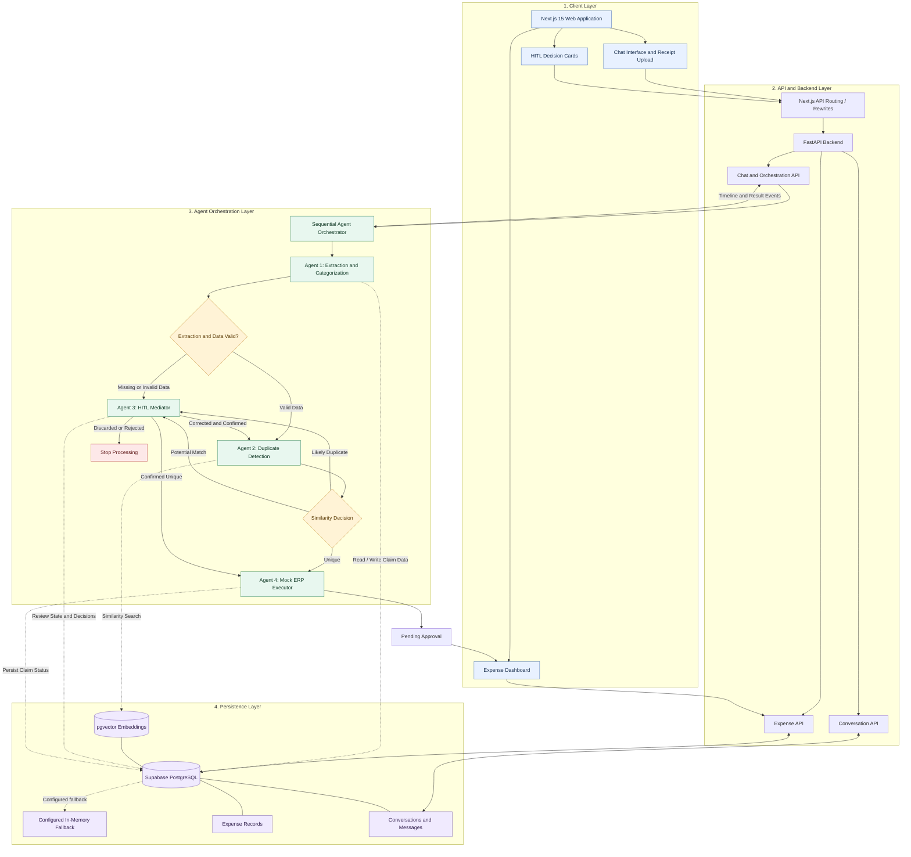
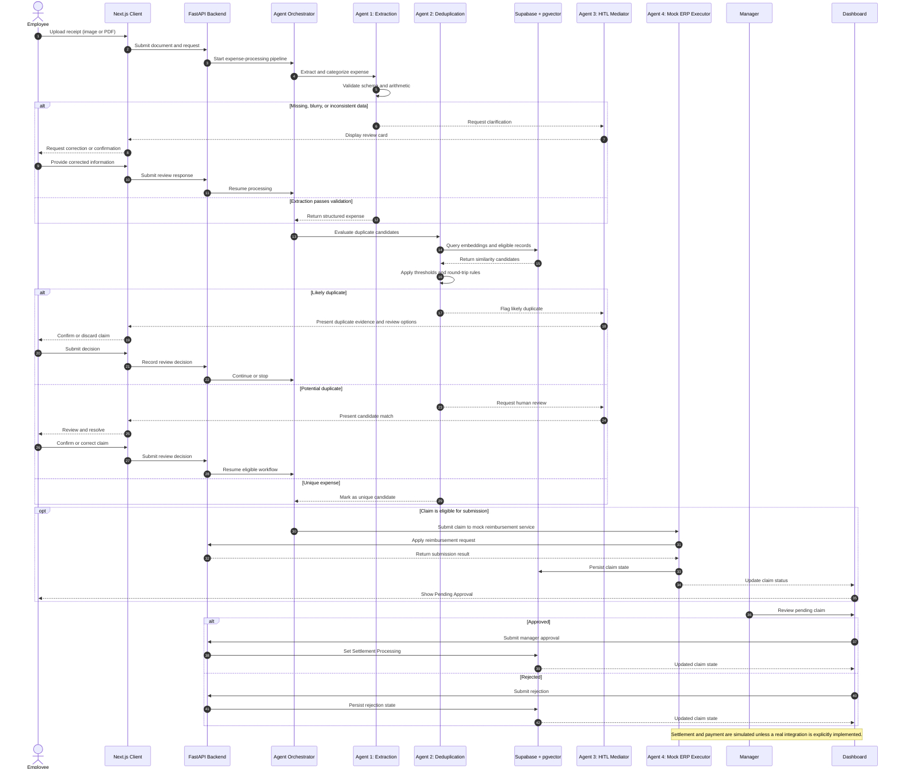
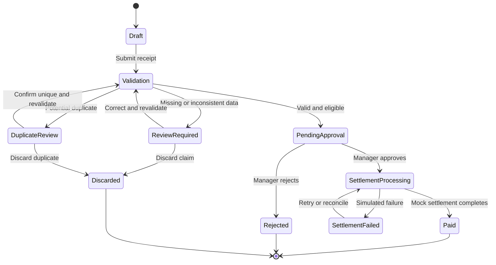

# 🚀 Agentic Expense Tracker & Mock Reimbursement System

An autonomous, multi-agent expense reimbursement platform that combines **multimodal receipt extraction, semantic duplicate detection, human-in-the-loop (HITL) review, and mock enterprise reimbursement execution**.

The system demonstrates how specialized AI agents can coordinate receipt processing, validate extracted financial data, identify potential duplicate claims, escalate uncertain cases for human review, and track reimbursement status through a dashboard.

> **Project scope:** This is a demonstration application with mock reimbursement execution. It is not a production financial system and does not initiate real payments or post transactions to a live ERP.

## ✨ Key Features

- **Multimodal receipt processing:** Upload receipt images and PDF documents for structured expense extraction.
- **Configurable LLM providers:** Support for configured hosted or local model providers, subject to the application's adapters and model capabilities.
- **Structured data validation:** Validate extracted fields against a schema and check whether line-item totals reconcile with the receipt total.
- **Semantic duplicate detection:** Use embeddings and Supabase PostgreSQL with `pgvector` to identify potential duplicate or near-duplicate claims.
- **Human-in-the-loop mediation:** Review missing, blurry, inconsistent, or ambiguous receipt data through interactive decision cards.
- **Round-trip trip handling:** Apply the project's round-trip cab logic to help distinguish legitimate return journeys from duplicate-looking claims.
- **Mock reimbursement execution:** Submit eligible claims through the mock reimbursement API.
- **Employee and manager workflows:** Support employee claim submission and manager review actions.
- **Lifecycle tracking:** Follow claims from draft through approval, settlement processing, and paid status.
- **Automated verification:** Exercise core workflows and edge cases through the project's verification suite.
- **Fallback handling:** Support offline or fallback behavior where configured; fallback persistence should not be treated as equivalent to durable database storage.

## 🏗️ System Architecture

The architecture is organized into four logical layers: client, API and backend, agent orchestration, and persistence. The backend coordinates a sequential, rule-driven pipeline of four specialized agents.

### Architecture diagram



### Technology stack

| Layer | Technologies |
|---|---|
| Frontend | Next.js 15, React, Tailwind CSS, Lucide icons |
| Backend | Python, FastAPI |
| AI and extraction | Configured multimodal LLM provider and structured extraction pipeline |
| Duplicate detection | Text embeddings, cosine similarity, Supabase `pgvector` |
| Database | Supabase PostgreSQL |
| Persistence fallback | Configured in-memory and client-side fallback mechanisms |
| Verification | Project-specific automated verification suite |
| Reimbursement integration | Mock reimbursement API |

The precise model identifiers and available provider options depend on the current configuration and provider adapters.

## 🔄 End-to-End Expense Workflow



> The diagrams describe the intended logical workflow. Confirm endpoint names, persistence behavior, and individual transition rules against the implementation before treating the diagrams as an exact runtime trace.

## 🤖 The Four Specialized Agents

### Agent 1 — Extraction and Categorization

**Responsibility:** Convert unstructured receipt documents into structured expense data.

Key responsibilities:

- Process supported receipt images and PDFs.
- Extract fields such as vendor, bill date, invoice number, line items, total amount, currency, and expense category where available.
- Validate the extracted structure against the expected schema.
- Check whether the sum of line items reconciles with the extracted total.
- Escalate missing, blurry, or inconsistent information for review.
- Support multi-page document handling where implemented by the extraction pipeline.

**Design principle:** Extracted model output is untrusted input until it passes validation.

### Agent 2 — Semantic Duplicate Detection

**Responsibility:** Identify potential duplicates and near-duplicates before reimbursement submission.

The documented implementation uses normalized claim text, embeddings, cosine similarity, and Supabase `pgvector`.

Key responsibilities:

- Generate an embedding from standardized expense information.
- Query eligible historical claims using configured metadata filters.
- Compare candidate similarity scores.
- Apply the configured duplicate decision thresholds.
- Account for the project's round-trip cab handling logic.
- Route uncertain matches to the HITL mediator.

#### Similarity decision policy

| Similarity score | Intended handling |
|---|---|
| `≥ 0.95` | Flag as a likely duplicate and prevent ordinary automatic submission pending the configured resolution path. |
| `0.85–<0.95` | Escalate as a potential duplicate for human review. |
| `< 0.85` | Treat as a lower-similarity candidate; continue only if the remaining validation and policy checks pass. |

These are application decision thresholds, not calibrated guarantees of fraud or duplicate status. Tune them against representative labeled data.

**Duplicate detection boundary:** The documented database function filters candidates by employee/user and bill date. It should not be described as organization-wide or cross-user duplicate detection unless the actual query and access policies support that behavior.

### Agent 3 — Human-in-the-Loop Mediator

**Responsibility:** Resolve cases that cannot be safely processed automatically.

Potential review triggers include:

- Missing or low-confidence metadata.
- Blurry or incomplete receipts.
- Arithmetic inconsistencies.
- Potential duplicate matches.
- Round-trip cab exceptions or other ambiguous scenarios.

The review interface may present actions such as confirming uniqueness, correcting extracted values, or discarding a claim.

A review decision should return to the orchestrator through a validated workflow transition. A user's confirmation should not silently bypass unrelated validation or authorization requirements.

### Agent 4 — Mock ERP Executor

**Responsibility:** Submit eligible claims to the mock reimbursement endpoint and update their application status.

The documented flow calls:

`/api/v1/mock-reimbursement/apply`

The mock executor demonstrates the submission boundary without claiming to execute a real ERP transaction or payment.

Key responsibilities:

- Submit an eligible claim to the mock service.
- Handle the response according to the application's configured workflow.
- Record the resulting claim state.
- Make the updated status available to the dashboard.

A real enterprise integration would require authentication, authorization, idempotency, retry handling, reconciliation, and audit logging.

## 📊 Claim Lifecycle

The dashboard tracks claims across the reimbursement workflow.



The diagram illustrates the intended lifecycle, not a guarantee that every state or transition is currently implemented. Verify the actual status enum and transition guards in the code.

## 👥 Roles and Dashboard

### Employee

The demonstration employee (`emp_402`) can:

- Upload receipts and initiate processing.
- Interact with the expense-processing workflow.
- Respond to HITL decision cards.
- Review extracted data and validation results.
- Track claim status in the dashboard.

### Manager

The demonstration manager (`mgr_101`) can:

- Review claims awaiting approval.
- Inspect claim details and available validation evidence.
- Approve a pending claim to move it to settlement processing.
- Reject a claim where the workflow permits rejection.
- Track updated claim states.

**Security note:** These example identifiers and any role-switching controls are for demonstration purposes. Production access control must be enforced on the server using authenticated identities, role checks, and ownership or tenant authorization—not client-side state alone.

## 🧪 Automated Verification

Run the verification suite:

```bash
npm run test:verify
```

The supplied project test scenarios cover the following cases:

| Test | Scenario | Expected behavior |
|---|---|---|
| A | Valid cab receipt | Pass extraction and validation; proceed toward submission if eligible. |
| B | Consecutive duplicate receipt | Detect the likely duplicate and stop ordinary automatic submission. |
| C1 | Round-trip cab with inverted routes | Apply the configured round-trip handling logic. |
| C2 | Multi-page grouped document | Return distinct expense items where supported. |
| C3 | Blurry or incomplete metadata | Trigger HITL review. |
| C4 | Line-item total mismatch | Trigger a review or validation exception. |

A successful test run demonstrates the cases covered by the suite; it does not establish production readiness, fraud-detection accuracy, or comprehensive security.

## ⚙️ Quick Start

### Prerequisites

Install the runtimes and services required by the current project configuration:

- Node.js and npm.
- Python and `pip`.
- A supported LLM provider, or a configured mock/local provider.
- Optional: a Supabase project with PostgreSQL and `pgvector`.

### 1. Clone the repository

```bash
git clone <YOUR_GITHUB_REPOSITORY_URL>
cd <YOUR_REPOSITORY_DIRECTORY>
```

Replace the placeholders with your actual repository URL and directory name.

### 2. Install backend dependencies

Create and activate a Python virtual environment:

```bash
python3 -m venv venv
source venv/bin/activate
pip install -r requirements.txt
```

On Windows, activate the virtual environment with:

```powershell
venv\Scripts\activate
```

### 3. Install frontend dependencies

```bash
npm install
```

### 4. Configure environment variables

Create `.env.local` in the project root, or copy the provided example if one exists.

The exact variable names should match the application's current configuration. The following is a template based on the project's documented settings:

```bash
# LLM provider and model
NEXT_PUBLIC_LLM_PROVIDER="gemini"
GEMINI_API_KEY="your-gemini-api-key"
GEMINI_MODEL="your-supported-model-id"

# Optional: xAI Grok
GROK_API_KEY="your-xai-api-key"

# Optional: local Ollama / compatible endpoint
OLLAMA_API_BASE="http://localhost:11434/v1"
OLLAMA_MODEL="gemma2"

# Optional: Supabase
NEXT_PUBLIC_SUPABASE_URL="https://your-project.supabase.co"
NEXT_PUBLIC_SUPABASE_ANON_KEY="your-public-client-key"

# Server-only secret; never expose this in browser code
SUPABASE_SERVICE_ROLE_KEY="your-service-role-key"
```

Use only the providers and model identifiers actually supported by the installed adapter. If the application supports a mock or offline mode, configure it according to the implementation.

**Credential safety:**

- Never commit `.env.local` or real API keys.
- Keep service-role credentials on the server.
- Use placeholder values in screenshots, examples, and public documentation.
- Rotate any credential accidentally published to a public repository.

### 5. Configure Supabase (optional)

If using Supabase, open the Supabase Dashboard and navigate to **SQL Editor**.

Run the project's database schema from:

`src/lib/supabase/schema.sql`

The documented schema includes:

- An `expenses` table.
- A `pgvector` embedding column.
- An HNSW vector index.
- A `match_expenses` similarity-search function.

Check that the database vector dimension matches the selected embedding model's output. Review the function's metadata filters and access controls before enabling it for multiple employees or tenants.

If Supabase is not configured, the application may use its supported fallback mode. Confirm the actual fallback behavior and remember that in-memory state can be lost when the process restarts.

### 6. Start the backend

If the repository includes the documented startup script:

```bash
./start_backend.sh
```

The technical design documents the FastAPI backend on port `8000`.

Alternatively, use the repository's documented Uvicorn command if the startup script is unavailable. Confirm the correct module path from the project source.

### 7. Start the frontend

In a separate terminal, run:

```bash
npm run dev
```

Open:

[http://localhost:3000](http://localhost:3000)

Confirm that the frontend can reach the backend and that the configured LLM and database providers are available.

## 🗂️ Important Implementation Areas

The technical design identifies the following modules as key parts of the system:

| Module | Responsibility |
|---|---|
| `backend/agents/orchestrator.py` | Coordinates sequential agent handoffs and collects workflow events. |
| `backend/agents/extraction_agent.py` | Extracts structured expense data from receipt content. |
| `backend/agents/deduplication_agent.py` | Generates or uses embeddings and evaluates candidate duplicate claims. |
| `backend/llm/client.py` | Provides the LLM client or provider integration. |
| `src/lib/supabase/schema.sql` | Defines the documented database schema and vector search components. |

File names and locations may change as the code evolves; use the repository tree as the source of truth.


## 🎬 Project Demo

Watch the complete walkthrough of the Agentic Expense Tracker & Mock Reimbursement System.

[](https://www.youtube.com/watch?v=8Wei4zgB2KY)

▶️ [Watch the video on YouTube](https://www.youtube.com/watch?v=8Wei4zgB2KY)


## 🔐 Security, Reliability, and Limitations

This is a technical demonstration. Before adapting it to real employee expenses, review the following areas:

- **Identity and roles:** Enforce employee and manager authorization server-side.
- **Claim ownership:** Ensure every claim, conversation, and attachment is accessed only by an authorized user.
- **Duplicate boundaries:** The documented user/date filters limit the search scope; cross-user detection requires an intentional design change.
- **Similarity accuracy:** Semantic similarity can produce false positives and false negatives. It should complement deterministic checks, not be treated as proof of fraud.
- **Document handling:** Validate file types and sizes, preserve source receipts, and protect uploaded files from unauthorized access.
- **Financial validation:** Treat model output as untrusted and validate required fields, currency, arithmetic, and business rules.
- **Database durability:** In-memory and client-side fallbacks are not substitutes for backups, durable storage, and recovery procedures.
- **Idempotency:** Production submission and settlement operations should protect against duplicate writes during retries.
- **Secrets:** Keep server credentials and provider API keys out of browser bundles and source control.
- **Auditability:** Record meaningful state changes, reviewer decisions, and submission outcomes.
- **ERP and payment scope:** The current executor is mock-oriented; do not assume that a real ERP posting or payment has occurred.

## 🚧 Potential Future Enhancements

The following are proposed extensions, not claims that they are already implemented:

1. **Explainable duplicate review:** Show matched claim evidence, field-level differences, and the reason for escalation.
2. **Calibrated matching:** Evaluate thresholds on labeled duplicate and legitimate-repeat examples.
3. **Broader duplicate detection:** Add carefully authorized cross-user or cross-business-unit matching where policy permits.
4. **Expense policy FAQ agent:** Answer policy questions using approved, versioned policy documents.
5. **Natural-language claim status agent:** Explain claim state and required next actions using authenticated claim data.
6. **Improved workflow orchestration:** Add intent-based routing only when the use cases justify it, while retaining deterministic controls for financial state transitions.
7. **Operational observability:** Track errors, retry outcomes, latency, provider usage, and cost per claim.
8. **Production resilience:** Add durable queues, idempotency keys, backup/restore procedures, and reconciliation.
9. **Enhanced review experience:** Add field-level confidence, accessible review controls, and a clear comparison between extracted and corrected values.

## 🤝 Contributing

Contributions, bug reports, and suggestions are welcome.

1. Fork the repository.
2. Create a feature branch.
3. Make your change and add or update tests.
4. Run the available verification suite.
5. Submit a pull request describing the change and its validation.

Please avoid including real receipts, personal information, API keys, or production credentials in issues and pull requests.


## 🙌 Acknowledgements

Built as a demonstration of agentic AI, multimodal document extraction, semantic search, human-in-the-loop workflows, and expense-process automation.

If you find the project useful, consider giving the repository a ⭐ and sharing feedback or improvement ideas.