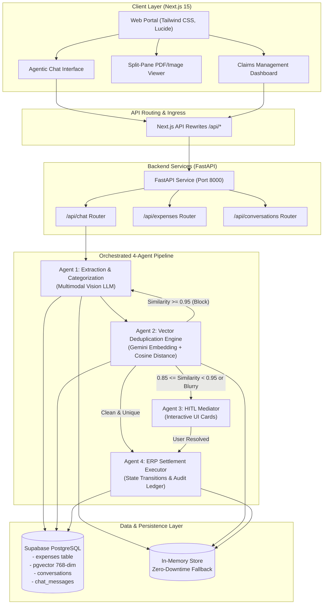
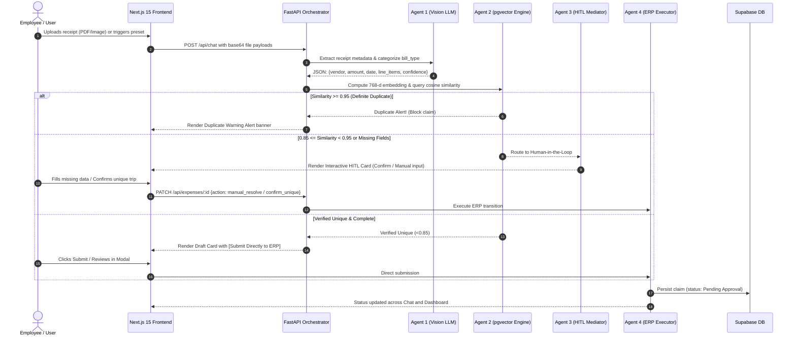

# Technical Design Document: Autonomous Expense Tracker & Reimbursement System

---

## 1. Project Overview & Track Selected

### 1.1 Track Selected
**Autonomous Agentic Systems & Financial Automation (Multi-Agent LLM Architecture)**

### 1.2 Executive Overview
The **Autonomous Expense Tracker & Reimbursement Platform** is an enterprise-grade agentic financial solution. Traditional corporate expense reimbursement is labor-intensive, error-prone, and vulnerable to duplicate and fraudulent claims. This project eliminates friction by deploying a 4-agent collaborative architecture that autonomously ingests receipts (PDFs & images), extracts granular line items, validates duplicate claims via high-dimensional semantic vector search (`pgvector`), engages employees through human-in-the-loop (HITL) exception mediation, and submits verified expenses to an ERP ledger.

### 1.3 Key Objectives
- **Multimodal Document Processing**: Zero-effort receipt parsing across diverse formats (Cab receipts, Fuel invoices, Flight bookings, Multi-page itemized bills, and degraded/blurry images).
- **Fraud & Semantic De-duplication**: Cosine distance similarity evaluation in vector space to detect identical receipts and near-duplicate claims.
- **Graceful Exception Mediation (HITL)**: Preventing pipeline halt by prompting users for missing metadata or override confirmations only when necessary.
- **Enterprise Lifecycle Management**: Complete expense workflow tracking from `Draft` ➔ `Pending Approval` ➔ `Settlement Processing` ➔ `Paid` / `Rejected`, with role-based access for Employees and Managers.

---

## 2. System Architecture & Flow Diagrams

### 2.1 High-Level Architecture Diagram



### 2.2 End-to-End Pipeline Execution Flow



---

## 3. Setup and Deployment Instructions

### 3.1 Prerequisites
- **Node.js**: v18.17.0+ or v20.x
- **Python**: 3.9+ or 3.11+
- **Supabase Account**: With `pgvector` extension enabled
- **Google Gemini API Key**: For multimodal vision and embedding generation

### 3.2 Environment Variables Configuration
Create a `.env.local` file in the project root:

```ini
# LLM & Vision Provider Configuration
NEXT_PUBLIC_LLM_PROVIDER="gemini"
GEMINI_API_KEY="AIzaSy..."
GEMINI_MODEL="gemini-3.1-flash-lite"
GEMINI_EMBEDDING_MODEL="gemini-embedding-2"

# Supabase Credentials (PostgreSQL & pgvector)
NEXT_PUBLIC_SUPABASE_URL="https://your-project-id.supabase.co"
NEXT_PUBLIC_SUPABASE_ANON_KEY="your-anon-publishable-key"

# Internal Backend Proxy
BACKEND_URL="http://127.0.0.1:8000"
```

### 3.3 Database Setup (Supabase SQL)
Run the following DDL script in your Supabase SQL Editor:

```sql
-- Enable vector extension
CREATE EXTENSION IF NOT EXISTS vector;

-- Expenses table with vector embeddings
CREATE TABLE IF NOT EXISTS expenses (
    id UUID PRIMARY KEY DEFAULT gen_random_uuid(),
    user_id TEXT NOT NULL,
    bill_type TEXT NOT NULL,
    bill_date DATE,
    vendor_name TEXT NOT NULL,
    total_amount NUMERIC(12,2) NOT NULL,
    currency TEXT DEFAULT 'INR',
    payment_mode TEXT DEFAULT 'UPI',
    remarks TEXT,
    specific_details JSONB DEFAULT '{}'::jsonb,
    status TEXT DEFAULT 'Draft',
    embedding vector(768),
    created_at TIMESTAMPTZ DEFAULT NOW(),
    updated_at TIMESTAMPTZ DEFAULT NOW()
);

-- Conversations tracking
CREATE TABLE IF NOT EXISTS conversations (
    id TEXT PRIMARY KEY,
    user_id TEXT NOT NULL,
    title TEXT NOT NULL,
    created_at TIMESTAMPTZ DEFAULT NOW(),
    updated_at TIMESTAMPTZ DEFAULT NOW()
);

-- Chat messages storage
CREATE TABLE IF NOT EXISTS chat_messages (
    id UUID PRIMARY KEY DEFAULT gen_random_uuid(),
    conversation_id TEXT REFERENCES conversations(id) ON DELETE CASCADE,
    sender TEXT NOT NULL,
    text TEXT,
    files JSONB DEFAULT '[]'::jsonb,
    events JSONB DEFAULT '[]'::jsonb,
    hitl_cards JSONB DEFAULT '[]'::jsonb,
    draft_cards JSONB DEFAULT '[]'::jsonb,
    created_at TIMESTAMPTZ DEFAULT NOW()
);

-- Cosine distance similarity RPC function
CREATE OR REPLACE FUNCTION match_expenses (
  query_embedding vector(768),
  filter_user_id text,
  filter_bill_date date,
  match_threshold float,
  match_count int
)
RETURNS TABLE (
  id uuid,
  user_id text,
  bill_type text,
  bill_date date,
  vendor_name text,
  total_amount numeric,
  similarity float
)
LANGUAGE plpgsql
AS $$
BEGIN
  RETURN QUERY
  SELECT
    expenses.id,
    expenses.user_id,
    expenses.bill_type,
    expenses.bill_date,
    expenses.vendor_name,
    expenses.total_amount,
    1 - (expenses.embedding <=> query_embedding) AS similarity
  FROM expenses
  WHERE expenses.user_id = filter_user_id
    AND expenses.bill_date = filter_bill_date
    AND 1 - (expenses.embedding <=> query_embedding) > match_threshold
  ORDER BY expenses.embedding <=> query_embedding
  LIMIT match_count;
END;
$$;
```

### 3.4 Local Development Runbook

```bash
# 1. Clone repository
git clone https://github.com/tinku2603/AITASK.git
cd AITASK

# 2. Python Virtual Environment & Backend dependencies
python3 -m venv venv
source venv/bin/activate
pip install -r requirements.txt

# 3. Node Dependencies
npm install

# 4. Start Backend Server (Port 8000)
./start_backend.sh

# 5. In a separate terminal, start Next.js Frontend (Port 3000)
npm run dev
```
Open **`http://localhost:3000`** in your browser.

### 3.5 Production Deployment (Render Blueprint)
The project includes a single-service `render.yaml` specification:

- **Build Command**:
  ```bash
  pip install -r requirements.txt && npm install && npm run build
  ```
- **Start Command**:
  ```bash
  (PYTHONPATH=. python -m uvicorn backend.main:app --host 0.0.0.0 --port 8000 &) && npm start
  ```
- **Memory Guard**: Configured with `NODE_OPTIONS=--max-old-space-size=460` in `package.json` to prevent heap exhaustion on standard cloud tiers.

---

## 4. Code Explanations and Assumptions

### 4.1 Detailed Code Modules

#### 1. Backend Orchestrator (`backend/agents/orchestrator.py`)
- Acts as the central pipeline controller.
- Takes incoming user attachments and prompts, coordinates the sequential agent handoffs, gathers timeline events (`EXTRACTING`, `DEDUPLICATING`, `HITL_TRIGGERED`, `EXECUTING`), and constructs the final UI payload containing draft cards and warnings.

#### 2. Agent 1: Extraction & Categorization (`backend/agents/extraction_agent.py` & `backend/llm/client.py`)
- Utilizes Gemini Vision models (`gemini-3.1-flash-lite`, `gemini-3.8-flash`) to perform optical character and structured JSON extraction.
- **Resilience Design**: If external Vision APIs encounter rate limits, network timeouts, or schema mismatches, it gracefully activates a deterministic regex and heuristic parsing engine, guaranteeing zero 500 crashes.

#### 3. Agent 2: De-duplication Engine (`backend/agents/deduplication_agent.py`)
- Standardizes claim text representation: `f"{vendor_name} {bill_date} {total_amount}"`.
- Generates 768-dimensional normalized embeddings via `gemini-embedding-2`.
- Queries Supabase using cosine similarity distance metric `<=>`.
- Enforces strict fraud prevention:
  - Exact/Near Duplicate ($S \ge 0.95$): Halts pipeline immediately.
  - Partial match ($0.85 \le S < 0.95$): Triggers Agent 3.

#### 4. Agent 3: HITL Mediator (`backend/agents/hitl_mediator.py` & `src/components/InteractiveCard.tsx`)
- Inspects data integrity for null fields, OCR smudges, and mathematical inconsistencies (line items sum vs total).
- Generates inline interactive cards in chat. Rather than crashing or requiring re-upload, users resolve issues with 1 click directly in the conversation flow.

#### 5. Agent 4: ERP Executor (`backend/agents/erp_executor.py` & `backend/routes/expenses.py`)
- Implements state transition validation.
- Transitions claims from `Draft` to `Pending Approval`.
- Provides full REST API compliance (`GET`, `POST`, `PATCH`, `DELETE` on `/api/expenses/:id`).

#### 6. Split-Pane Document Viewer (`src/components/PdfReceiptSplitViewer.tsx`)
- Employs native `<object>` and `<embed>` container architecture.
- Bypasses browser restrictions against cross-context blob URLs (`Not allowed to load local resource`).
- Provides zoom, 90° rotation, and multi-file switching for side-by-side verification.

#### 7. Deletion & Persistence Guard (`src/components/DashboardTab.tsx` & `src/components/ChatInterface.tsx`)
- Maintains authoritative sync between backend REST responses and browser local storage.
- Tracks `aitask_deleted_expense_ids` to permanently prevent deleted claims from resurrecting upon chat or dashboard tab switching.

---

### 4.2 System Assumptions

1. **User Identity & Role Context**:
   - Assumes a single active employee session (`emp_402`) for standard submissions, switchable to Manager (`mgr_101`) for approval/rejection operations.
2. **Currency Standard**:
   - Default currency is assumed to be INR (`₹`), with support for foreign transactions handled through remarks and conversion flags.
3. **Receipt Authenticity & Deduplication Boundary**:
   - Deduplication evaluates claims submitted by the **same employee** on the **same calendar date**. Distinct users or different dates with identical amounts (e.g., daily cab commutes) are preserved.
4. **Offline & Fallback Durability**:
   - Assumes network drops or temporary external API outages must not block the user. The application seamlessly cascades from Supabase ➔ in-memory store ➔ client storage.
5. **No File Mutation**:
   - Uploaded PDF and image binaries are treated as immutable records; corrections alter metadata fields while preserving the original uploaded document hash.
